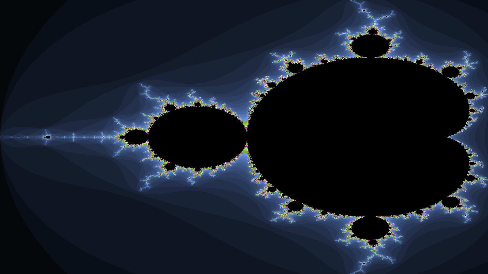

# Parallel Programming in C++ & CUDA
Samuel Habib · Rutgers University · ECE 451

Coursework exploring CPU threading, SIMD vectorization, GPU kernels, and numerical computation.

| Project | Implementation | Technical focus |
| --- | --- | --- |
| [CUDA Mandelbrot](mandelbrot-cuda/) | GPU escape-time computation with a scalar CPU baseline and WebP output | CUDA kernels, 2D launch geometry, device memory, CUDA event timing |
| [SIMD Mandelbrot](mandelbrot-simd/) | Eight-pixel vectorized escape-time computation with an included rendered image | AVX2/FMA intrinsics, lane masks, divergence, scalar remainder handling |
| [Reciprocal Summation](reciprocal-summation/) | Forward and backward harmonic-series summation with 1, 2, 4, 8, and 16 threads | Work partitioning, floating-point accumulation order, elapsed-time measurement |
| [Parallel Sieve](parallel-sieve/) | Work toward a multithreaded, bit-packed Sieve of Eratosthenes | Prime precomputation, bit indexing, thread partitioning |

## CUDA Mandelbrot
The [GPU assignment](https://github.com/RU-ECE/ECE451-Parallel/blob/main/hw/Mandelbrot_GPU.md) calls for a CUDA or HIP implementation, comparison with a scalar CPU baseline, GPU identification, and an output image. The submission uses the specified 1280 × 1024 image, 256-iteration limit, and coordinate range of −1 to 1 on both axes.

The source records the following measurements on an **NVIDIA A100-SXM4-40GB**:

| Measurement | Recorded time |
| --- | --- |
| Scalar CPU | 0.597128 s |
| GPU kernel only | 0.000181248 s |
| GPU computation and result transfer, including allocation | 0.00154744 s |

The recorded CPU-to-GPU-total ratio is approximately **386×**. These are submission measurements, not independently reproduced benchmarks; image encoding is outside the timed GPU interval. The program computes both CPU and GPU results but does not automatically compare their escape-count arrays.

Build from `mandelbrot-cuda/` with the CUDA toolkit and libwebp development files:

```sh
nvcc -O3 -std=c++17 -arch=sm_80 --fmad=false -Xcompiler -ffp-contract=off mandelbrot.cu -o mandelbrot -lwebp
./mandelbrot
```

The supplied command targets an A100-class GPU.

## SIMD Mandelbrot
A separate CPU implementation renders a 1920 × 1080 image with a 512-iteration limit. It processes eight single-precision coordinates per vector, tracks active lanes with masks, and handles remaining pixels with a scalar loop. It writes PPM and WebP images.

The instructor's [SIMD Mandelbrot hints](https://github.com/RU-ECE/ECE451-Parallel/blob/main/sessions/old2025/07/00b_mandelbrot_hw_hints.cpp) discuss eight-lane coordinates and divergent escape counts. This is distinct from the CUDA assignment.

Build from `mandelbrot-simd/` on a CPU supporting AVX2 and FMA, with libwebp development files:

```sh
g++ -O3 -std=c++17 -mavx2 -mfma mandelbrot.cpp -o mandelbrot -lwebp
./mandelbrot
```



## Reciprocal Summation
[HW1](https://github.com/RU-ECE/ECE451-Parallel/blob/main/sessions/02/HW1.md) asks for forward/backward summation of reciprocals and single-thread versus multithread benchmarks. The submission uses **10 billion terms**, compared with 100 million in the assignment, and includes 1/2/4/8/16-thread runs. Backward accumulation is implemented for the one-thread case.

```sh
cd reciprocal-summation
g++ -O3 -std=c++17 -pthread count_reciprocals.cpp -o count_reciprocals
./count_reciprocals
```

The workload is fixed in the source and runs several full summations. The downloaded submission passes a C++ syntax check; its full benchmark has not been rerun.

## Parallel Sieve
[HW2](https://github.com/RU-ECE/ECE451-Parallel/blob/main/sessions/03/HW2_super_eratosthenes.md) asks for prime precomputation through √n followed by a multithreaded sieve using odd-number bits packed into 64-bit words.

This submission is an **unfinished implementation**. It does not currently compile: `<vector>` is missing and the worker calls refer to a nonexistent `eratosthenes` method. The allocation and initialization sizes also differ, and the work ranges remain fixed. It is included as coursework in progress rather than a working benchmark.

## Build verification
The original source files are unchanged. CUDA is unavailable in the review environment, and the SIMD build is blocked by missing WebP headers. GPU and SIMD execution have not been revalidated.
